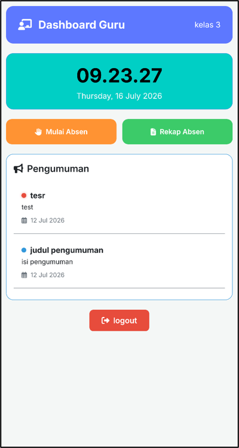
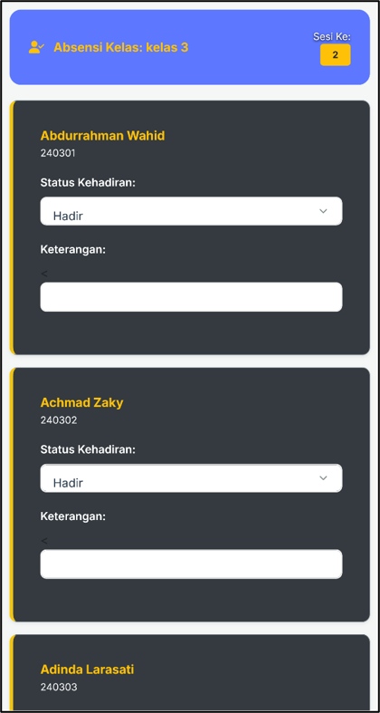
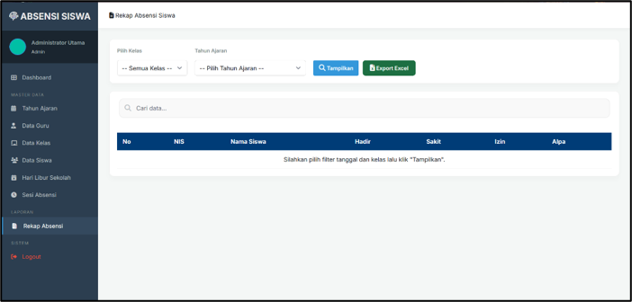
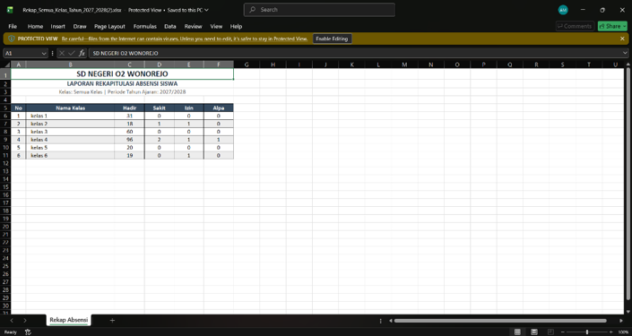
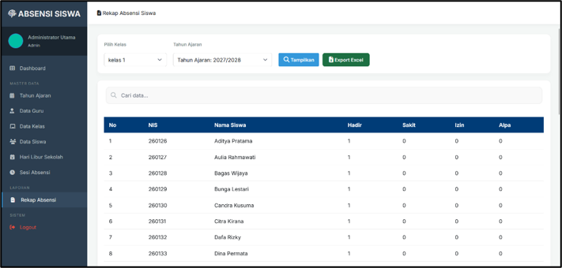
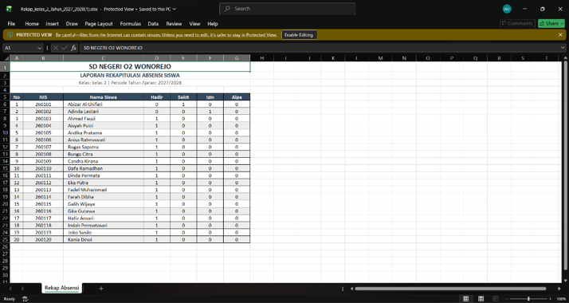
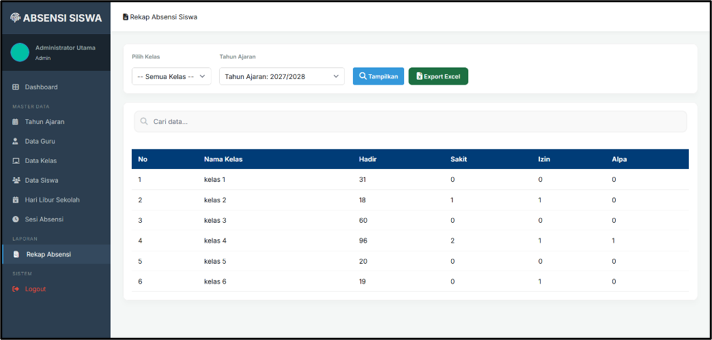

# 🏫 Mobile-Friendly Digital Student Attendance System – SD Negeri 2 Wonorejo

[](https://laravel.com)
[](https://php.net)
[](https://mysql.com)
[](https://vitejs.dev)
[-brightgreen?style=for-the-badge)](#-system-testing--evaluation)

A responsive, web-based digital attendance information system engineered to modernize student attendance management at **SD Negeri 2 Wonorejo, Pekalongan Regency**. Developed with **Laravel 11** and **PHP 8.2**, this application provides a seamless mobile interface for teachers to perform real-time daily attendance tracking directly from smartphones, while streamlining administrative data processing and automated report generation.

> **Project Status:** Completed & Validated (Undergraduate Thesis in Informatics Engineering - Institut Widya Pratama Pekalongan, 2026).

---

## 📸 Application Screenshots

*(Place your application screenshots inside the `screenshots/` directory)*

| Teacher Dashboard (Mobile UI) | Attendance Form |
| :---: | :---: |
|  |  |

| Admin Recapitulation | Excel Report Export |
| :---: | :---: |
|  |  |
|  |  |
|  |

---

## ✨ Key Features

### 👨‍🏫 Teacher Module (Classroom Management)
- **Smartphone-Optimized UI:** Responsive layout designed for fast classroom operation via mobile web browsers.
- **Multi-Factor Verification:** Verification supporting location radius checks, QR Code scanning, and fallback manual PIN input.
- **Session-Based Attendance Input:** Record student status (Present, Sick, Permitted, Absent) with custom notes per lesson hour.
- **Automatic Holiday Blocking:** Prevents invalid submissions on school holidays and academic calendar break days.
- **Class Recapitulation & Export:** Real-time summary views and one-click `.xlsx` Excel report generation.

### 👨‍💼 Administrator Module (Academic Operations)
- **Real-Time Analytics Dashboard:** Visual graphs showing cross-class attendance trends and weekly summaries.
- **Master Data Management:** Full CRUD operations for Teachers, Classes, Students, and School Announcements.
- **Academic Year Transition:** Batch class upgrade utility and academic year transitions without overwriting historical records.
- **Operating Sessions & Holiday Scheduler:** Customizable time slots and central holiday management.
- **Global Recapitulation:** School-wide attendance monitoring and exportable reports for archival purposes.

---

## 🛠️ Tech Stack & Architecture

- **Backend Framework:** Laravel 11.x (PHP 8.2)
- **Database:** MySQL (InnoDB Engine with Foreign Key Constraints & Database Transactions)
- **Frontend & Assets:** Blade Templating, Vite, JavaScript, Responsive CSS
- **Development Methodology:** Waterfall SDLC Model (Analysis, Design, Implementation, Testing, Deployment, Maintenance)
- **System Modeling:** Unified Modeling Language (UML) & Screen Layout Worksheets (LKT)

---

## 🧪 System Testing & Evaluation

The software underwent rigorous technical and empirical evaluations:

1. **White Box Testing (Basis Path & Cyclomatic Complexity):**
   - Conducted on the critical `store` attendance function.
   - Resulted in **Cyclomatic Complexity $V(G) = 4$**, proving highly efficient code logic, strong modularity, and low operational risk.
2. **Black Box Testing (Equivalence Partitioning):**
   - Validated input boundaries for Login, Academic Year, and Student Registration modules.
   - Achieved **100% Validation Rate** for correct input handling and error prevention.
3. **User Acceptance Testing (UAT):**
   - Field-tested with 6 Homeroom Teachers and Administrative Staff.
   - Attained a score of **92.85%**, falling into the **"Highly Feasible"** category for full deployment.

---

## 🚀 Local Installation Guide

Follow these steps to set up the project locally:

### Prerequisites
- PHP >= 8.2
- Composer
- Node.js & NPM
- MySQL Database Server

### Setup Steps

1. **Clone Repository**
   ```bash
   git clone https://github.com/4174179/laravel-absensi.git
   cd laravel-absensi
   ```

2. **Install PHP & Node Dependencies**
   ```bash
   composer install
   npm install
   ```

3. **Configure Environment (.env)**
   Copy `.env.example` to `.env`:
   ```bash
   cp .env.example .env
   ```
   Set up your database credentials:
   ```env
   DB_CONNECTION=mysql
   DB_HOST=127.0.0.1
   DB_PORT=3306
   DB_DATABASE=db_absensi_sd
   DB_USERNAME=root
   DB_PASSWORD=
   ```

4. **Generate App Key & Run Migrations**
   ```bash
   php artisan key:generate
   php artisan migrate --seed
   ```

5. **Build Assets & Start Server**
   ```bash
   npm run build
   php artisan serve
   ```
   Access the application at `http://127.0.0.1:8000`.

---

## 👤 Author & Developer

- **Name:** Anang Miftakhul Falah
- **Department:** B.Sc. in Informatics Engineering – Faculty of Information Technology
- **Institution:** Institut Widya Pratama Pekalongan, Central Java, Indonesia
- **Advisors:** Taryadi, M.Cs & Amanah, M.Kom

---

## 📜 License

Distributed under the **MIT License**. See `LICENSE` for details. Developed for academic purposes at Institut Widya Pratama Pekalongan.